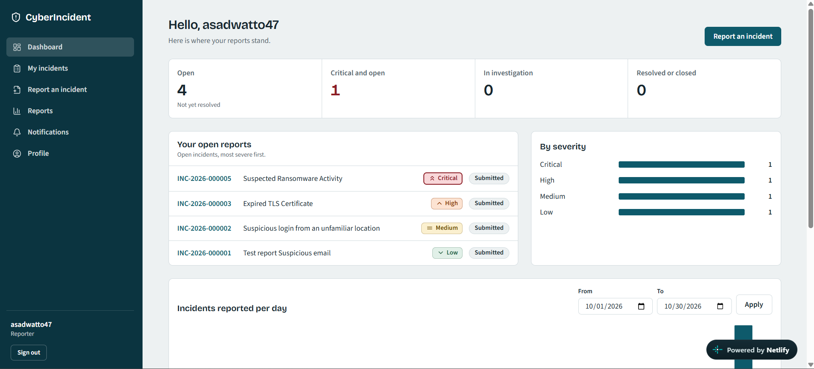
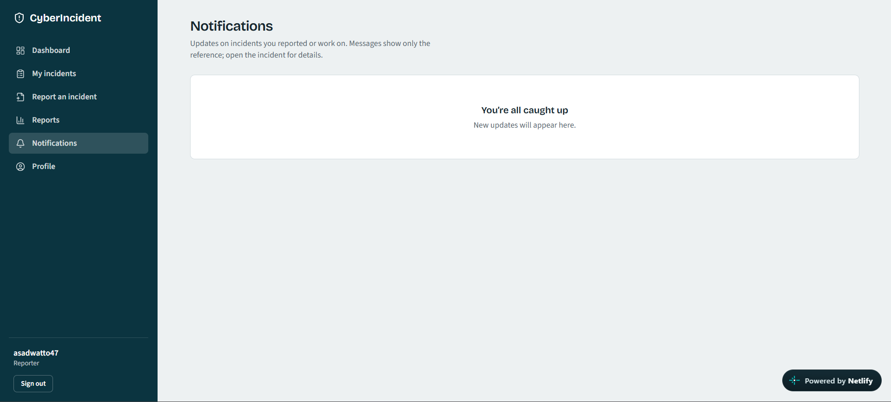
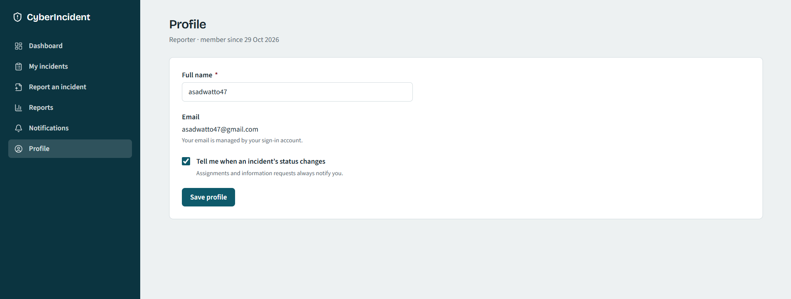

# CyberIncident
### Cybersecurity Incident Reporting & Management Platform

**Report. Track. Manage. Secure.**

CyberIncident is a web-based cybersecurity incident reporting and management platform designed to help organizations centralize the reporting, documentation, and tracking of cybersecurity incidents.

The platform provides an organized environment where authenticated users can report security incidents, monitor their progress, review incident timelines, and receive in-app notifications. Authorized personnel can manage incident information through role-based access controls and structured workflows.

Built using modern web technologies, CyberIncident combines a responsive user interface with secure authentication, database-level access controls, private evidence storage, and audit-oriented incident management.

The project demonstrates the practical application of full-stack web development, database security, authentication, authorization, and cybersecurity incident management concepts.

**Live Application:** https://cyberincident-hub.netlify.app  
**GitHub Repository:** https://github.com/ASAD1960/CyberIncident

## 1. Technology Stack

CyberIncident uses a modern web development stack combining frontend technologies, backend services, database management, and security tools.

| Technology | Purpose |
|---|---|
| Next.js 15 | Full-stack React framework and application routing |
| React 19 | Component-based user interface |
| TypeScript | Type-safe application development |
| Tailwind CSS 3 | Responsive interface styling |
| Supabase Auth | User authentication and session management |
| Supabase PostgreSQL | Relational database and persistent storage |
| Supabase Storage | Private incident evidence storage |
| Zod | Input and schema validation |
| Lucide React | Interface icons |
| Recharts | Data visualization and charts |
| Node.js | JavaScript runtime |
| Git & GitHub | Version control and source code management |
| Netlify | Application deployment and hosting |

### Technology Highlights

- **Next.js and React:** Used to develop the application interface, authenticated pages, dashboard, and server-side functionality.
- **TypeScript:** Provides type safety and consistency across application components and services.
- **Tailwind CSS:** Used to build a responsive and consistent user interface.
- **Supabase:** Provides authentication, PostgreSQL database services, and private file storage.
- **Zod:** Validates application inputs and maintains structured data validation.
- **Recharts:** Supports data visualization and dashboard charts.
- **Git and GitHub:** Used for source code management and version control.

## 2. Project Overview

CyberIncident addresses the need for a centralized and structured approach to cybersecurity incident reporting.

In many organizations, security concerns are communicated through emails, messages, or informal channels. This can make it difficult to maintain consistent records, monitor progress, and review incident history.

CyberIncident provides a dedicated platform where users can submit incident reports and authorized personnel can review and manage them.

### Main Goals

- Centralized incident reporting.
- Structured incident documentation.
- Incident status and timeline tracking.
- Role-based access management.
- Secure handling of incident evidence.
- Audit-oriented record keeping.
- Report summaries and CSV exports.

## 3. Problem Statement

Organizations face different types of cybersecurity incidents, including phishing attempts, suspicious account activity, unauthorized access, and potential data exposure.

Without an organized reporting and tracking process, incident information may become scattered across different communication channels.

This can create difficulties in:

- Collecting consistent incident information.
- Tracking the progress of reported incidents.
- Maintaining historical records.
- Controlling access to sensitive information.
- Reviewing incident-related activities.

CyberIncident aims to address these challenges through a centralized incident reporting and management environment.

## 4. Project Objectives

- Develop a centralized cybersecurity incident reporting platform.
- Provide authenticated incident submission functionality.
- Organize incident information in a structured format.
- Support incident tracking and timeline visibility.
- Implement role-based access control.
- Protect sensitive information through application and database security.
- Maintain audit-oriented incident records.
- Provide reporting and export functionality.

## 5. Applications in Organizations

CyberIncident can be used in different organizational environments to support internal cybersecurity reporting and incident management processes.

### 5.1 IT Departments

- Receive reports about suspicious system activity.
- Maintain records of reported security incidents.
- Track incident status and investigation progress.
- Review incident timelines and related information.

### 5.2 Educational Institutions and Universities

- Allow students and staff to report suspected phishing emails.
- Report suspicious online activity and account-related concerns.
- Provide IT administrators with a centralized reporting interface.
- Maintain incident records for review and follow-up.
- Support internal cybersecurity awareness initiatives.

### 5.3 Businesses and Corporate Organizations

- Provide employees with a structured way to report cybersecurity concerns.
- Organize reports involving suspicious emails and unauthorized access.
- Document potential data exposure incidents.
- Monitor incident progress.
- Maintain records of incident-related activities.

### 5.4 Cybersecurity and IT Support Teams

- Receive and review submitted incident reports.
- Monitor incident timelines and status changes.
- Manage incident information according to assigned permissions.
- Review report summaries.
- Export relevant information for further analysis.

### 5.5 Small and Medium-Sized Organizations

- Establish a centralized incident reporting process.
- Reduce reliance on scattered email-based reporting.
- Maintain structured incident records.
- Introduce basic incident tracking without requiring a large-scale security management platform.

> **Note:** CyberIncident is an incident reporting and management platform. It does not replace a full Security Information and Event Management (SIEM) system, automated threat detection platform, or dedicated Security Operations Center (SOC).

## 6. Key Features

### Authentication and User Management

- User authentication through Supabase Auth.
- Password recovery functionality.
- Role-based access management.
- Profile management.

### Incident Management

- Structured cybersecurity incident reporting.
- Incident information management.
- Incident status tracking.
- Incident timeline and history.
- Report summaries.

### Dashboard and Notifications

- Centralized dashboard.
- Incident-related information.
- In-app notifications.
- Organized navigation.

### Reporting and Evidence

- CSV report exports.
- Private evidence storage.
- Evidence validation.
- Controlled evidence access.
- Audit-oriented activity records.

### Security

- Database Row Level Security (RLS).
- Server-side authorization checks.
- Restricted database permissions.
- Protected audit and history records.
- Secure evidence download handling.

## 7. Application Walkthrough — From Login to Incident Management

The following screenshots demonstrate the application in the order a user would normally experience it, starting from authentication and continuing through incident reporting, tracking, notifications, and profile management.

### Step 1 — Login Page

The login page provides the main entry point to the CyberIncident platform.


### Step 2 Login with User Credentials

Demonstrates the user authentication experience.


### Step 3 Dashboard

After authentication, users are directed to the dashboard, which provides an overview of the application and its incident-related information.



### Step 4 Sidebar Navigation

The sidebar provides navigation between the main application sections and features.


### Step 5 Report an Incident

Users can submit cybersecurity incidents through a structured reporting interface.


### Step 6 Report Submitted

Demonstrates the confirmation interface after an incident report has been submitted.


### Step 7 Reports Timeline and Information

Users can review incident reports, timelines, and related information.


### Step 8 Incident Reports Per Day

An additional view of incident reporting activity organized by day.


### Step 9 Report Summary

Presents a structured overview of incident information.


### Step 10 Additional Report Summary

An additional view showing further incident information.


### Step 11 Notifications

Users can view in-app notifications related to the platform.



### Step 12 User Profile

The profile section allows users to view and manage their account information.



## 8. System Architecture

CyberIncident follows a layered application architecture.

| Layer | Responsibility |
|---|---|
| Presentation Layer | Next.js and React user interface |
| Application Layer | Server Actions, request validation, and rate limiting |
| Service Layer | Incident, evidence, audit, notification, and reporting operations |
| Authentication Layer | Session management and role-based authorization |
| Database Layer | PostgreSQL, RLS policies, and workflow functions |
| Storage Layer | Private evidence storage and controlled downloads |

The application combines frontend access controls with server-side authorization and database-level security to protect sensitive incident information.

## 9. Project Structure

The main application structure under `src/` is organized as follows:

| Directory | Responsibility |
|---|---|
| `app/(auth)` | Login and password recovery |
| `app/(app)` | Authenticated application pages |
| `app/api` | Evidence download and CSV export endpoints |
| `actions/` | Server Actions and application operations |
| `lib/services/` | Business logic and data access |
| `lib/validation/` | Zod validation schemas |
| `lib/workflow/` | Incident status transition rules |
| `lib/auth/` | Session helpers and permission checks |
| `lib/security/` | Rate limiting, file validation, and SHA-256 utilities |
| `lib/supabase/` | Supabase browser, server, admin, and middleware clients |
| `components/` | Reusable UI and application components |

## 10. Security Implementation

Security is a core consideration in CyberIncident. The application uses multiple layers of protection.

### Authentication and Authorization

- Supabase Auth handles user authentication.
- Server-side role checks protect authenticated functionality.
- PostgreSQL Row Level Security policies restrict database access.
- Database column grants provide additional access restrictions.

### Incident Data Protection

- Reporters can access only their own incidents.
- Reporter-visible notes and timeline events are controlled through visibility settings.
- Administrators can access incident metadata but cannot automatically access internal notes.
- Administrator evidence access is controlled by a setting and is disabled by default.

### Audit and History Protection

- Incident history and audit logs are append-only.
- Database triggers protect audit and history records against modification and deletion.
- Workflow changes are handled through database functions that validate transitions and record related history and audit entries.

### Evidence Security

- Evidence files are stored in a private storage bucket.
- File extensions and file signatures are validated.
- Generated storage paths are used.
- SHA-256 hashes are recorded.
- Signed download URLs are short-lived.
- Evidence operations are audited.

### Additional Security Measures

- Generic login and password-reset responses help prevent account enumeration.
- In-memory rate limiting is implemented.
- CSV exports neutralize spreadsheet formula injection.
- Security headers and Content Security Policy are configured.
- The Supabase service-role key is restricted to a server-only module.

## 11. Database and Access Control

CyberIncident uses Supabase PostgreSQL for persistent data storage.

Database security is enforced through:

- Row Level Security policies.
- Role-based permissions.
- Restricted profile-column access.
- Database workflow functions.
- Append-only incident history and audit records.
- Private evidence storage.

The application uses database-level controls alongside application-level authorization rather than relying only on frontend restrictions.

## 12. Incident Workflow

The general incident reporting workflow is:

1. A user signs in to the platform.
2. The user opens the incident reporting section.
3. The user enters the incident information.
4. The incident report is submitted.
5. The system stores the incident information.
6. The user can review the report and its timeline.
7. Relevant incident information and notifications are displayed through the application.
8. Authorized personnel manage incident information according to their permissions.

Status transitions are governed by the application's workflow rules and database controls.

## 13. Installation and Setup

### Prerequisites

- Node.js
- npm
- Git
- A Supabase account

### Step 1 — Clone the Repository

```bash
git clone https://github.com/ASAD1960/CyberIncident.git
```

### Step 2 — Open the Project

```bash
cd CyberIncident
```

### Step 3 — Install Dependencies

```bash
npm install
```

### Step 4 — Configure Supabase

Create a Supabase project.

Open the Supabase SQL Editor and execute the initial database migration:

```text
supabase/migrations/0001_init.sql
```

### Step 5 — Configure Environment Variables

Copy the example environment file:

```powershell
Copy-Item .env.example .env.local
```

Add the required Supabase project URL, anonymous key, and service-role key to `.env.local`.

**Security note:** Never commit `.env.local` or expose the service-role key in frontend code or a public repository.

### Step 6 — Configure Authentication Redirects

In Supabase Authentication URL Configuration, add the local callback URL:

```text
http://localhost:3000/auth/callback
```

### Step 7 — Create Users

Create users through Supabase Authentication.

New users initially receive the `reporter` role.

To promote the first administrator, execute the following SQL after replacing the email address:

```sql
UPDATE public.profiles
SET role = 'admin'
WHERE email = 'you@example.com';
```

Administrators can then use the application's Admin → Users functionality to create analysts.

### Step 8 — Start the Development Server

```bash
npm run dev
```

Open the following address in your browser:

```text
http://localhost:3000
```

## 14. Security Hardening Migration

For an installation that has already applied the initial database schema, the security hardening migration can be reviewed and applied separately.

Migration file:

```text
supabase/migrations/0002_security_hardening.sql
```

This migration tightens profile-column access, introduces caller-scoped profile functions and an administrator-only user-list function, and adds further protections for incident history.

Review and test the migration in a non-production Supabase project before applying it to production.

After applying it, validate authentication, profile display and editing, administrator user listing, incident reporter and assignee names, note permissions, and RLS policies.

## 15. Testing and Validation

Important areas for testing include:

- User authentication and password recovery.
- Reporter and administrator access permissions.
- Incident submission and viewing.
- Incident status transitions.
- Timeline and note visibility.
- Evidence upload and download permissions.
- Notifications.
- Profile display and editing.
- CSV export and truncation handling.
- Database Row Level Security policies.

## 16. Limitations and Future Improvements

Potential future improvements include:

- More advanced incident analytics and visualization.
- Enhanced filtering and search.
- Additional incident management workflows.
- Improved notification delivery options.
- Integration with external security monitoring tools.
- Shared rate limiting for serverless deployments.
- Expanded automated security and integration testing.

## 17. Important Implementation Notes

- Date and time inputs are interpreted and displayed as UTC.
- Email delivery is outside the current project scope.
- Notifications are in-app and display the incident reference.
- If workflow rules are changed, update both `lib/workflow/status.ts` and the database `status_transitions` table.
- In-memory rate limiting should be replaced with a shared solution such as Redis when deploying in a serverless environment.
- CSV exports include the `X-Report-Truncated: true` response header when the row limit is reached. Users should narrow their filters when they need a complete export.

## 18. License

This project is available under the license specified in the repository. Please check the repository's license file for applicable terms.

**CyberIncident — A centralized approach to cybersecurity incident reporting and management.**
